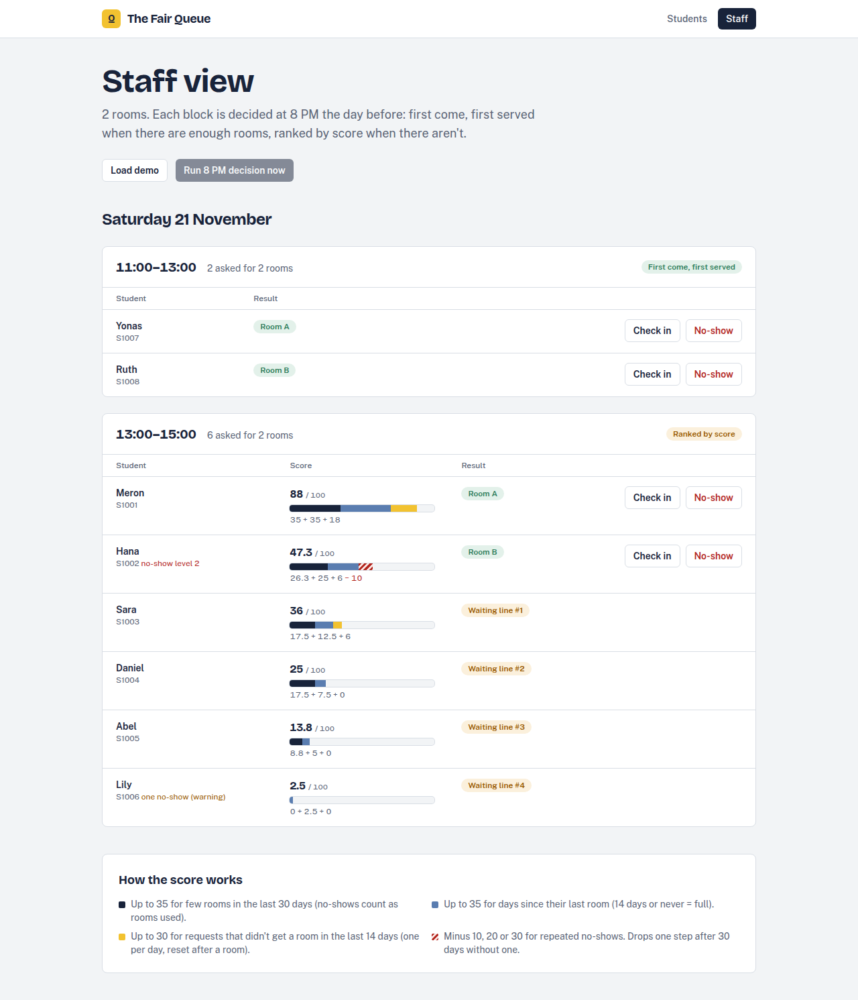
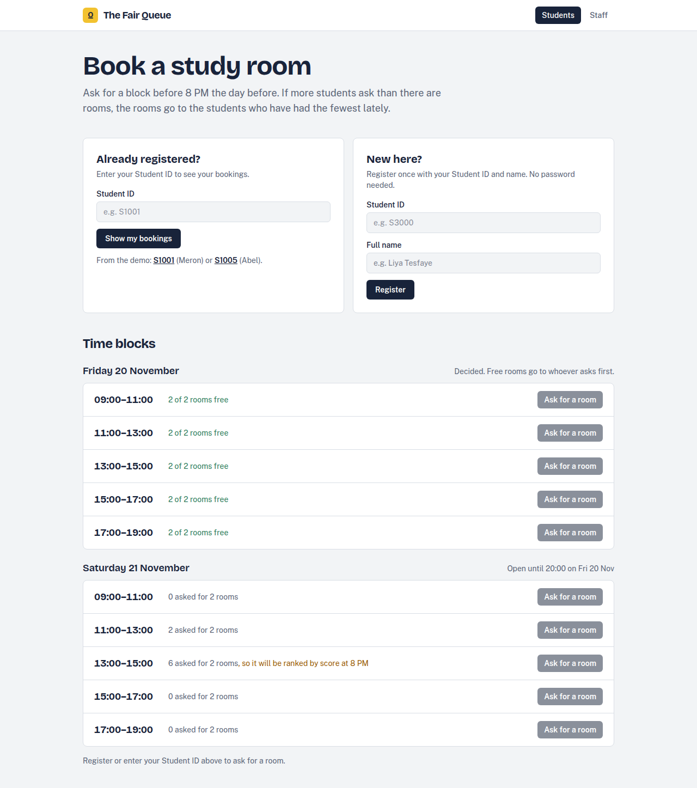
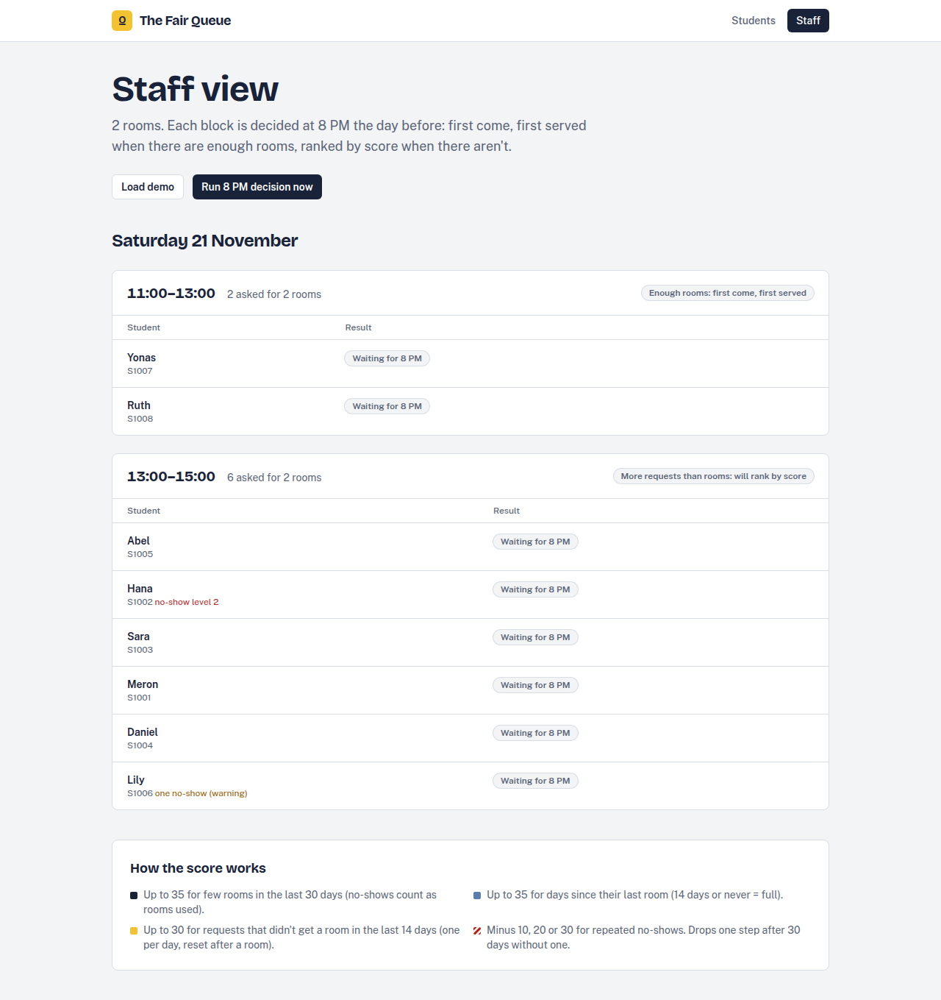
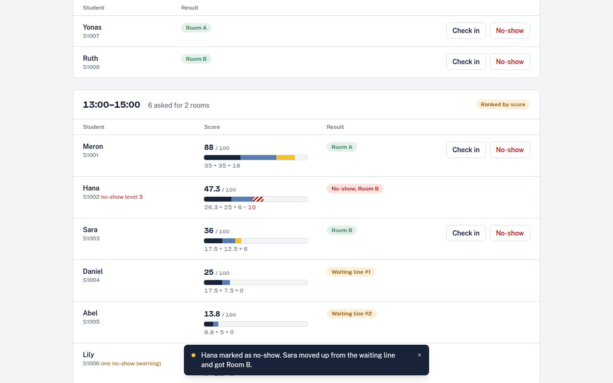
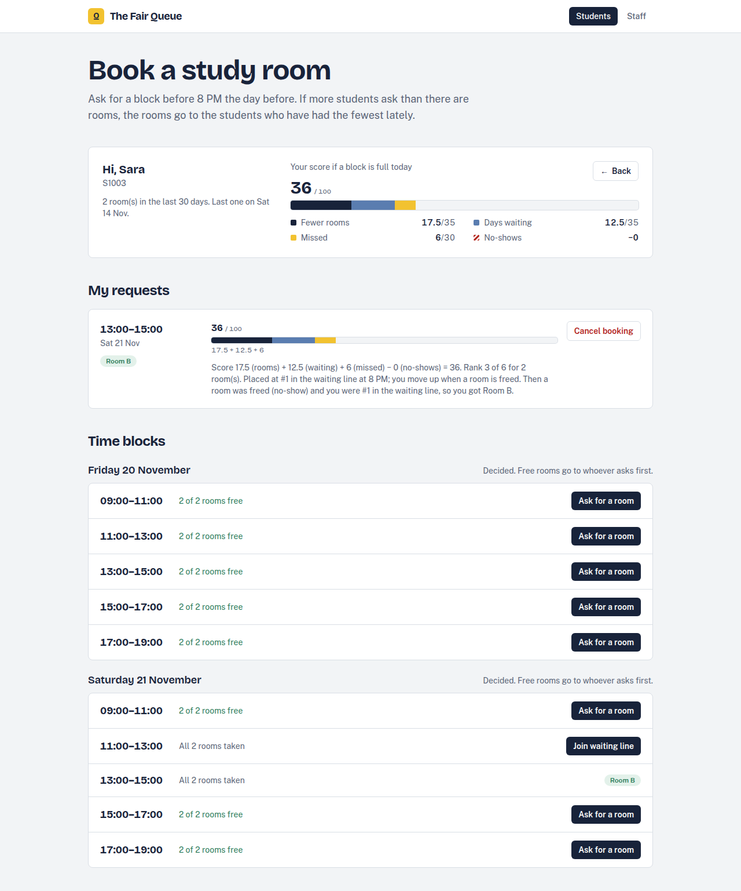

# The Fair Queue

A small web app that shares a university's study rooms fairly. When more students ask than there are rooms, the rooms go to the students who have had the fewest lately, and every decision shows its reason.



## How it decides

- The day has **fixed blocks**: 09–11, 11–13, 13–15, 15–17, 17–19. One room = one student.
- Students ask for a block **until 8 PM the day before**. Nothing is decided earlier, so being fastest doesn't matter.
- **At 8 PM**, for each block:
  - **Enough rooms** (e.g. 2 students, 2 rooms) → everyone gets a room, first come, first served.
  - **Too many requests** (e.g. 6 students, 2 rooms) → rooms go to the highest **priority score**. Everyone else joins the **waiting line** in score order. Ties go to whoever asked first.
- After 8 PM, a free room goes to whoever asks first.

### Priority score (0–100)

| Part | Points | Rule |
|---|---:|---|
| Recent rooms | up to 35 | Fewer rooms in the last 30 days = more points. No-shows count as rooms used. |
| Waiting time | up to 35 | More days since the last room = more points (14+ days or never = full). |
| Missed requests | up to 30 | Requests that didn't get a room in the last 14 days. At most one per day, reset after getting a room (so spamming requests doesn't help). |
| No-show penalty | 0 to −30 | 1 no-show = warning, 2 = −10, 3 = −20, 4+ = −30. Drops one step after 30 days without a no-show. |

A score depends only on the student's own history, never on who else applied.

### Cancel and no-show

- Cancel **2+ hours before** → no penalty.
- Cancel later, or **no check-in within 15 minutes** → counts as a no-show.
- Either way, the room goes straight to **#1 in the waiting line**, so it doesn't sit empty.

### Example decision

2 rooms, 6 students for 13:00–15:00. Abel asked first.

| Student | History | Score | Result |
|---|---|---:|---|
| Meron | Never had a room, missed 3 times | 88 | ✅ Room A |
| Hana | 1 room 10 days ago, 2 no-shows | 47.3 | ✅ Room B |
| Sara | 2 rooms, last 5 days ago, missed once | 36 | ⏳ Waiting line #1 |
| Abel | 3 rooms this month, last 2 days ago | 13.8 | ⏳ Waiting line #3 |

**Why this is reasonable:** Abel asked first, but he already had 3 rooms this month and Meron had none. Under first come, first served, the fastest students win every time. Here the student who has been left out goes first. Hana's no-shows cost her 10 points but don't lock her out. When Hana then doesn't show up, Sara gets her room automatically.

## Assumptions

- All rooms are the same, and one room holds one student.
- Students identify with a **Student ID**. There's no login or password; they register once with ID and name.
- Times use the server's local time.
- The staff page is open to anyone. It's a demo.

**Not built on purpose:** login, notifications, room sizes or equipment, recurring bookings, staff overrides.

**Would improve for a real product:** university login (SSO), notifying students when a room frees up, tuning the points with real usage data, staff exceptions (e.g. accessibility) with an audit log, and a background job for the 8 PM decision and automatic no-shows.

## Run it

Needs Node.js 20.9+ and a PostgreSQL database (I used [Neon](https://neon.tech)).

```bash
npm install
cp .env.example .env        # add your DATABASE_URL and DIRECT_URL
npx prisma migrate deploy   # create the tables
npm run db:seed             # load the demo data
npm run dev                 # open http://localhost:3000
npm test                    # 36 tests for the decision rules
```

## Try it yourself

1. Open **Staff** (`/admin`). The demo is loaded: 6 students asked for 13:00–15:00, which has only 2 rooms.
2. Press **Run 8 PM decision now**. Meron and Hana get rooms, and the rest wait in score order.
3. Press **No-show** on Hana. Sara moves up from the waiting line and gets Room B.
4. Open **Students** and enter `S1005` (Abel) to see his score and why he is waiting.
5. Press **Back**, then under **New here?** register a new Student ID with your name and ask for a room.

Press **Load demo** at any time to start over.

| | |
|---|---|
|  |  |
| Register or enter your Student ID | Before 8 PM: requests are collected |
|  |  |
| A no-show passes the room to the waiting line | A student sees their score and the reason |

## Technical choices

- **Next.js (App Router) + TypeScript**: pages and backend (server actions) in one small app.
- **PostgreSQL on Neon + Prisma**: a hosted database, so no local setup or Docker.
- **The rules are pure functions** ([`src/lib/allocation/`](src/lib/allocation/)): no database or UI inside, so they're easy to test and explain. All numbers are in one file, [`rules.ts`](src/lib/allocation/rules.ts).
- **The 8 PM decision runs when a page is opened after 8 PM**, so no background job is needed. A "Run 8 PM decision now" button triggers it for the demo.
- **Remote database:** bulk inserts, longer timeouts and automatic retries, because the connection to Neon was slow and sometimes dropped.

```
src/
├── app/            pages (students, staff) and server actions
├── components/     score bar, buttons, register form
├── database/       database connection
└── lib/
    ├── allocation/       scoring and decision rules (+ tests)
    ├── booking-service.ts  request, decide, cancel, no-show
    └── demo-data.ts        the example students
```

## How I used AI

I used **Claude** (Claude Code) as a pair programmer throughout. I made the decisions; Claude reviewed, suggested and wrote most of the code.

1. **Planned the allocation algorithm first.** I wrote my own design: priority factors with weights, a no-show penalty table, and the allocation steps. Claude reviewed it and found problems: the weights only added up to 85, "normalize to 0–100" wasn't defined, students could game the missed-requests factor, the penalty level and the no-show count contradicted each other, and without a deadline first come, first served would win anyway. I chose which fixes to keep and added my own rules: first come, first served when there's no competition, a freed room goes to the next person in line, and no long edge-case list.
2. **Planned the UI structure** before building: a student page and a staff page, fixed time blocks, and where students see their points and the reason.
3. **Made the technical decisions** together: Next.js full stack, Neon Postgres instead of Docker, and Student ID with no login.
4. **Built it in 5 phases** (rules + tests, demo data, backend, pages, README), checking each phase before moving on. I tested in the browser and asked for changes, such as a clearer register flow, a Back button and clearer folder names. Claude also tested the flows in a headless browser, which caught real bugs: slow demo loading, messages disappearing after a no-show, and an out-of-date waiting-line number.
